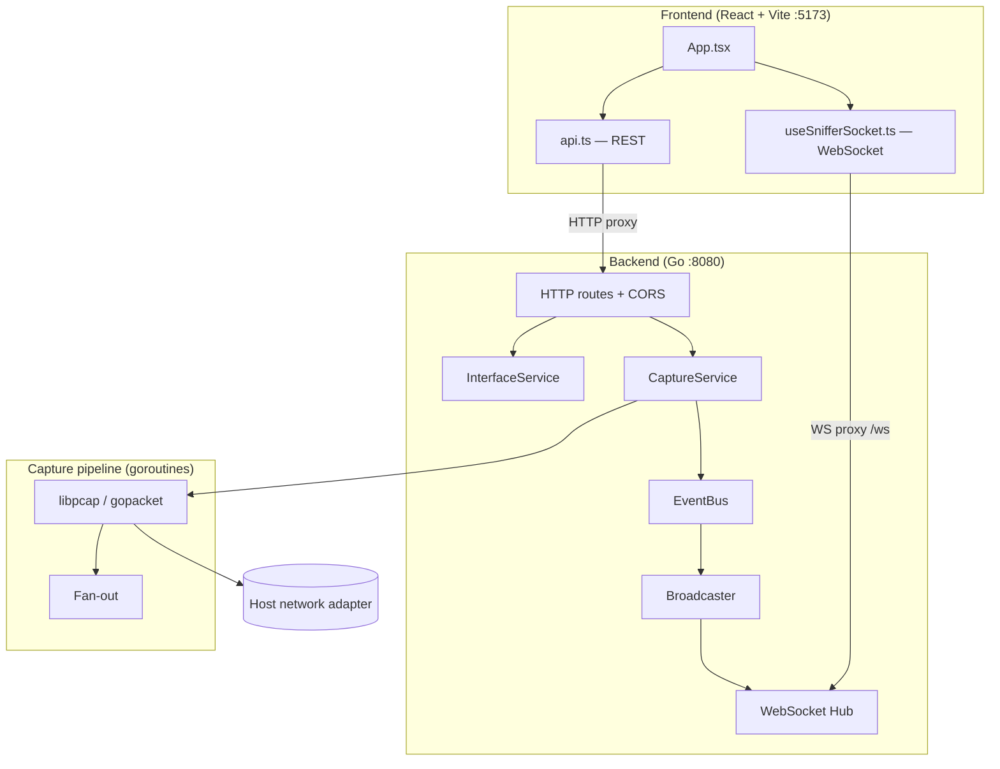
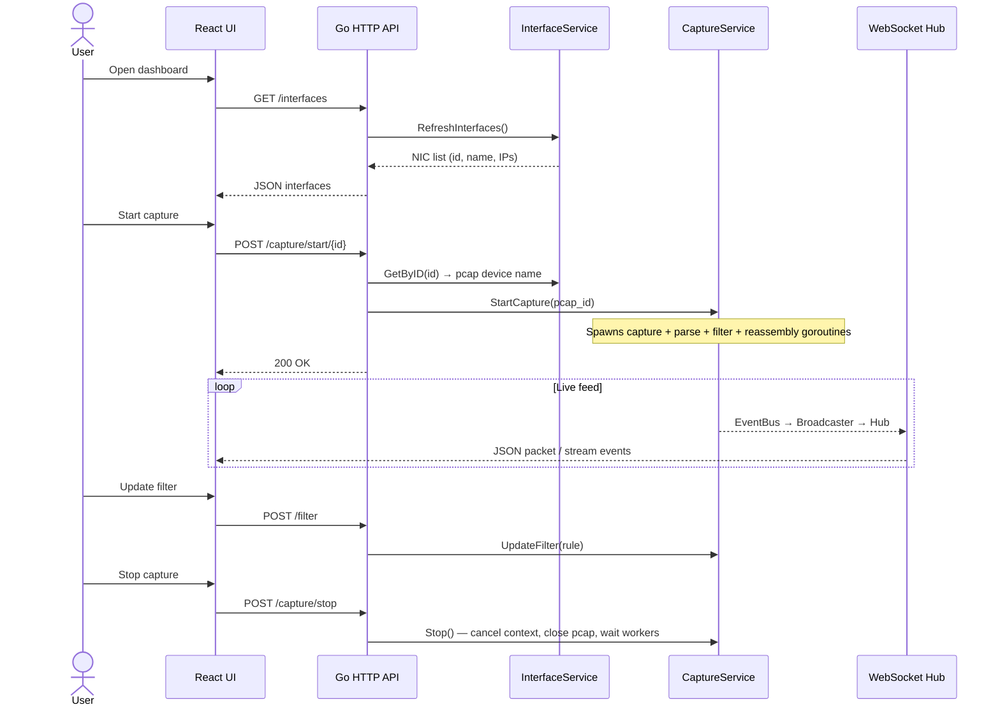
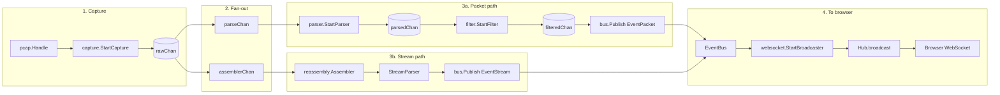
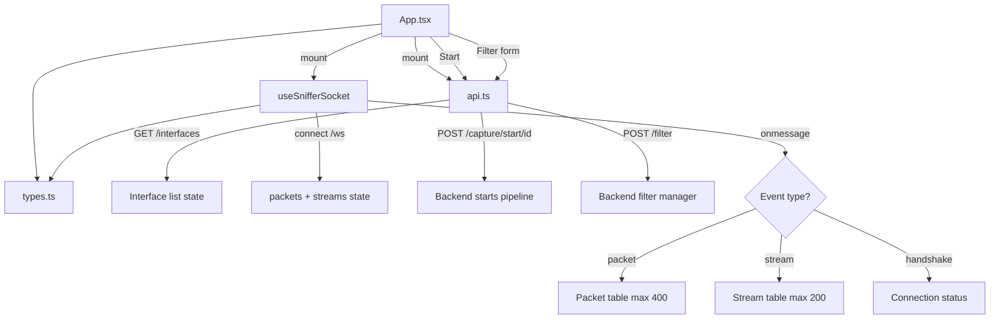

# Packet Sniffer

Real-time packet capture and inspection in the browser. The **Go** backend captures traffic on your machine with **libpcap** (gopacket); the **React** frontend shows live packets and streams over WebSocket.

Run it **on the host** (not in Docker) so the sniffer sees the same network interfaces and traffic as your PC. A Linux container only sees the container network, not packets on your Wi‑Fi or Ethernet adapter.

## Quick start

You need two terminals after cloning.

### 1. Clone

```bash
git clone <your-repo-url>
cd PacketSniffer
```

### 2. Backend (terminal 1)

```bash
cd backend
go run ./cmd/sniffer
```

API and WebSocket listen on **http://localhost:8080**.

### 3. Frontend (terminal 2)

```bash
cd frontend
npm install
npm run dev
```

Open **http://localhost:5173**, choose an interface, then **Start capture**.

---

## Requirements

| Tool | Version |
|------|---------|
| [Go](https://go.dev/dl/) | 1.24+ (see `backend/go.mod`) |
| [Node.js](https://nodejs.org/) | 20+ |
| Packet capture library | Platform-specific (below) |
| C compiler | Required for Go + libpcap (**CGO**) |

### Windows

1. Install **[Npcap](https://npcap.com/)** (WinPcap-compatible mode during setup is fine).
2. Install a C toolchain for CGO, e.g. [MSYS2](https://www.msys2.org/) with `pacman -S mingw-w64-x86_64-gcc`, and add `mingw64\bin` to your `PATH`.
3. Run the backend **as Administrator** so capture can open adapters.

```powershell
cd backend
$env:CGO_ENABLED="1"
go run ./cmd/sniffer
```

### Linux

```bash
sudo apt install -y gcc libpcap-dev   # Debian/Ubuntu
# or: sudo dnf install gcc libpcap-devel   # Fedora

cd backend
go run ./cmd/sniffer
```

Capture often needs elevated privileges (`sudo go run ...`) unless your user is in the `pcap` group.

### macOS

```bash
xcode-select --install
cd backend
go run ./cmd/sniffer
```

libpcap is included; you may be prompted for permission to capture.

---

## Architecture & design flow

The app splits into three layers: **UI** (React), **API + realtime** (HTTP + WebSocket), and **capture pipeline** (libpcap → parse → filter → bus). Control commands go in over HTTP; live data comes back over WebSocket.

### System overview



### Control flow (what the user triggers)



### Data pipeline (backend hot path)

When capture is running, each frame from the wire is duplicated into **two parallel pipelines**: per-packet parsing and TCP stream reassembly.



| Stage | Package / file | Role |
|-------|----------------|------|
| Open adapter | `internal/core/capture/pcap.go` | `pcap.OpenLive` + BPF filter |
| Read frames | `internal/core/capture/engine.go` | `PacketSource` → raw bytes |
| Fan-out | `internal/service/caputreservice.go` | Same raw frame to parser + assembler |
| Decode packet | `internal/core/parser/decoder.go` | IPv4, TCP/UDP, DNS fields → `models.Packet` |
| User filter | `internal/core/filter/` | `Manager` + rules from `POST /filter` |
| TCP streams | `internal/core/reassembly/` | Reassemble TCP → `StreamParser` (TLS SNI, etc.) |
| Events | `internal/core/bus/` | Pub/sub; slow consumers drop events |
| Realtime | `internal/api/websocket/` | JSON marshal → all connected clients |

### Backend startup wiring

`cmd/sniffer/main.go` calls `httpserver.StartServer()`, which:

1. Creates `InterfaceService` and `CaptureService`
2. Starts `websocket.Hub.Run()` in a goroutine
3. Subscribes the **Broadcaster** to `CaptureService`’s `EventBus`
4. Registers REST routes on `CentralHandler`
5. Attaches `GET /ws` for WebSocket upgrades

### Frontend design flow



- **REST** (`api.ts`): interfaces, start/stop capture, filter — defaults to `http://localhost:8080` (or Vite proxy paths if you point `VITE_API_BASE` at the dev server).
- **WebSocket** (`useSnifferSocket.ts`): connects to `/ws` on the current host (Vite proxies to `:8080` in dev).
- **UI caps**: last 400 packets and 200 streams in memory to keep the dashboard responsive.

### Runtime connection (dev)

```
Browser (localhost:5173)
    │  HTTP  /interfaces, /capture, /filter  → Vite proxy → :8080
    │  WS    /ws                             → Vite proxy → :8080
    ▼
Go API (:8080)  →  libpcap  →  your NICs (Wi‑Fi, Ethernet, etc.)
```

---

## Project layout

```
PacketSniffer/
├── backend/
│   ├── cmd/sniffer/              # Entrypoint
│   └── internal/
│       ├── api/                  # HTTP, WebSocket, routes, handlers
│       ├── service/              # CaptureService, InterfaceService
│       ├── core/
│       │   ├── capture/          # pcap open + read loop
│       │   ├── parser/           # Per-packet decode (DNS, TCP, …)
│       │   ├── filter/           # Rule engine
│       │   ├── reassembly/       # TCP stream assembly
│       │   ├── bus/              # Event pub/sub
│       │   └── netfaces/         # List host interfaces
│       └── models/               # Shared structs
├── frontend/
│   ├── src/App.tsx               # Dashboard UI
│   ├── src/api.ts                # REST client
│   └── src/useSnifferSocket.ts   # Live feed
└── README.md
```

`backend/Dockerfile` and `frontend/Dockerfile` are optional (Linux images only). They are **not** recommended for capturing traffic on your host machine.

---

## API

| Method | Path | Description |
|--------|------|-------------|
| `GET` | `/interfaces` | List capture-capable interfaces |
| `POST` | `/capture/start/{id}` | Start capture on interface id |
| `POST` | `/capture/stop` | Stop capture |
| `POST` | `/filter` | Update filter rules (JSON) |
| WebSocket | `/ws` | Live packet and stream events |

Default BPF filter in code (`backend/internal/core/capture/pcap.go`):

`tcp or udp port 53 or tcp port 443`

---

## Troubleshooting

| Issue | What to try |
|-------|-------------|
| `go run` fails with CGO / pcap errors | Install Npcap (Windows) or `libpcap-dev` (Linux). Set `CGO_ENABLED=1`. Install `gcc`. |
| Empty interface list | Npcap not installed (Windows), or backend not run as admin / with sufficient rights. |
| Start capture fails | Run backend elevated (Windows: Administrator). Close other sniffers using the same adapter. |
| UI cannot connect | Backend must be on `:8080` first. Use `npm run dev` (not only `build`) so the Vite proxy is active. |
| WebSocket disconnected | Confirm backend is running; check browser devtools → Network → WS to `localhost:5173/ws`. |

---

## License

Add your license here if you publish the repo.
